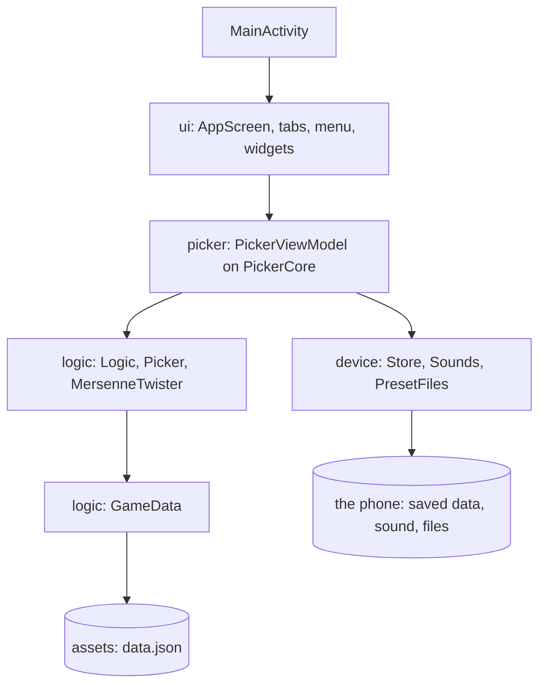

# Fresh Random Civ Picker for Android: maintainer's guide

1. [Adding a new civ](#adding-a-new-civ)
2. [How the code works](#how-the-code-works)
   - [Files and folders](#files-and-folders)
   - [Diagram](#diagram)
   - [Building the app](#building-the-app)
   - [Staying in step with the web version](#staying-in-step-with-the-web-version)
   - [The picker's rules](#the-pickers-rules)
   - [The view model](#the-view-model)
   - [The phone's side](#the-phones-side)
   - [The screen](#the-screen)
   - [The Draw tab](#the-draw-tab)
   - [The Log tab](#the-log-tab)
   - [The Pool tab](#the-pool-tab)
   - [The menu and the dialogs](#the-menu-and-the-dialogs)
   - [Tests](#tests)
   - [Rules for changing the code](#rules-for-changing-the-code)

## Adding a new civ

A new civ is added to the web version first; the app then takes it over. You need: this repository and the web
version's (`frcp_html`) in folders next to each other, JDK 17 or newer, the Android SDK (Android Studio installs it),
and the civ's icon as a PNG of 104 x 104 pixels. It takes about ten minutes. Commands are run in the project's folder,
in Git Bash on Windows.

1. **Check that the web version has the civ.** `../frcp_html/data.json` lists it under `civs`, with the next free
   `id`, and `../frcp_html/sounds/civ/` has its jingle. If not, add it there first, as that repository describes.
2. **Copy the shared files.** Run the sync tasks on their own, not together with a build:

   ```
   ./gradlew syncWebAssets syncWebTestFixtures
   ```

   You will see `BUILD SUCCESSFUL`. `git status` now shows `app/src/main/assets/data.json`, the new jingle in
   `app/src/main/assets/sounds/civ/` and the fixtures in `app/src/test/resources/fixtures/` as changed or new. If the
   web version is somewhere else, add `-PfrcpWebDir=<its folder>`.
3. **Add the civ's icon by hand.** Save the PNG as `app/src/main/assets/images/civ/<name>.png`, where `<name>` is the
   civ's name in `data.json` in lower case, such as `britons.png`. The app has civ icons of its own, so the sync tasks
   do not bring one.
4. **Run the tests.**

   ```
   ./gradlew testDebugUnitTest
   ```

   `BUILD SUCCESSFUL` means every test passed. A failure names the test by its number; look it up in
   [TESTS.md](TESTS.md). A missing icon or jingle fails a test that names the missing file: add the file. A failing
   share link or civ ID test means the civ's `id` in `data.json` moved an older civ's; IDs are permanent, so mend it
   in the web version and repeat from step 2.
5. **Try the app.** Build it as [Building the app](#building-the-app) says, install it, and check that the civ shows
   on the Pool tab, can be drawn, and plays its jingle.
6. **Check the Pool tab's room.** The civs never scroll: their rows shrink to fit the screen. If the names have become
   too small to read, or the civ came with a new DLC whose DLC toggle takes room, see [The Pool tab](#the-pool-tab).
7. **Record and commit.** Write the change in the last part of `documentation/DEVLOG/`, run
   `bash .github/scripts/check-rules.sh`, and commit.

A share link spends one character per drawn civ, out of 64, so the 65th civ needs a new link format in the web version
first.

## How the code works

The app is one screen on top of a view model, on top of the picker's rules. The rules are a port of the web version's
`logic.js`, so that the app, the web version and the desktop app read and write the same share links, presets and
saved state. Nothing in the rules knows about the screen, storage or sound, which is why the tests can check them on
a computer without a phone.

### Files and folders

| File or folder | What it holds |
| --- | --- |
| `app/src/main/java/net/frcp/app/` | `MainActivity.kt`, which opens the screen and hands share links to the view model. |
| `app/src/main/java/net/frcp/app/logic/` | The picker's rules: `Logic.kt`, `GameData.kt` (reads `data.json`) and `MersenneTwister.kt` (the random numbers). |
| `app/src/main/java/net/frcp/app/picker/` | The view model: `PickerCore.kt` (draws, undo, the civ pool), `PickerViewModel.kt` (menu, dialogs, share links, presets), `PickerView.kt` (what the screen shows), `Settings.kt`, `PickerFactory.kt`. |
| `app/src/main/java/net/frcp/app/device/` | What the app needs from the phone: `Store.kt` (saved data), `Sounds.kt`, `PresetFiles.kt`, and `Assets.kt` (where the assets are). |
| `app/src/main/java/net/frcp/app/ui/` | The screen: `AppScreen.kt`, `TabBar.kt` (the page art's measures), `Images.kt`, `Theme.kt`. |
| `app/src/main/java/net/frcp/app/ui/tabs/` | The three tabs: `DrawTab.kt` with `SwipeGesture.kt`, `LogTab.kt` with `LogPanel.kt` and `LogScrollBar.kt`, `PoolTab.kt`. |
| `app/src/main/java/net/frcp/app/ui/menu/` | `MainMenu.kt`, `Dialogs.kt`, `OptionsDialog.kt`. |
| `app/src/main/java/net/frcp/app/ui/widgets/` | Buttons, checkboxes and icons in `Controls.kt`; the slider, dropdown and text field in `Inputs.kt`. |
| `app/src/main/assets/` | `data.json`, the images and the sounds. All but the civ icons and the page art are copies of the web version's. |
| `app/src/main/res/` | The app's icon, name and window theme. |
| `app/src/main/AndroidManifest.xml` | Declares the one screen, portrait only, and that `https://frcp.net/` links open in the app. |
| `app/src/test/` | The tests, and the fixtures in `resources/fixtures/`; see [Tests](#tests). |
| `app/build.gradle.kts` | How the app is built, its version, and the sync tasks. |
| `app/proguard-rules.pro` | Empty but for a note: the release build's shrinking needs no exceptions. |
| `build.gradle.kts`, `settings.gradle.kts`, `gradle.properties` | The build's plugins, its one module `app`, and Gradle's settings. |
| `gradle/` | `libs.versions.toml`, the versions of everything the build uses, and the Gradle wrapper. |
| `gradlew`, `gradlew.bat` | Start Gradle, on Linux or macOS and on Windows. Gradle generates them. |
| `documentation/` | This guide, `RULES.md`, `REQUIREMENTS.md`, `TESTS.md`, `DECISIONS.md`, `TERMINOLOGY.md`, and the development log in `DEVLOG/`. |
| `README.md` | Introduces the project. |
| `LICENSE` | The terms under which anyone may use the project. |
| `AGENTS.md` | What an AI agent must know before it changes anything here: what to read first, what it must never do, and when a change is done. |
| `CLAUDE.md` | The same for Claude Code, which reads this file by itself. It loads `AGENTS.md` and `RULES.md`. |
| `.claude/skills/` | Step-by-step procedures for AI agents, one folder each, such as how to write the development log. `ub-mode` is copied from another project and keeps its licence beside it. |
| `.claude/settings.json` | Stops Claude Code from committing and from changing `REQUIREMENTS.md`. |
| `.github/` | What GitHub shows contributors: how to contribute, report a bug or a security hole, the pull request form, and the accessibility checklist. |
| `.github/workflows/checks.yml` | Tells GitHub to run the checks and the tests on every push and pull request. |
| `.github/scripts/check-rules.sh` | Checks the rules a script can check; see [Tests](#tests). |
| `.github/scripts/renumber-tests.py` | Renumbers the tests in the code and in `TESTS.md`; see [Tests](#tests). |
| `.gitattributes`, `.gitignore` | How Git treats line endings, and which files it leaves out. |

### Diagram



The screen reads what the view model shows and calls its actions; it never touches the rules or the phone itself.

### Building the app

You need JDK 17 or newer and Android SDK platform 37.2, which Android Studio installs. Open the folder in Android
Studio, or build from the command line:

```
./gradlew assembleDebug
./gradlew assembleRelease
```

The debug app is then at `app/build/outputs/apk/debug/app-debug.apk`, the release app at
`app/build/outputs/apk/release/app-release.apk`. Things to know:

- **The version** is `versionCode` and `versionName` in `app/build.gradle.kts`. Raise both for a release; the name is
  also written into the names of saved presets.
- **Signing.** Until the app has an upload key of its own, release builds are signed with the debug key, so they
  install on a phone for testing and update a debug build in place. Google Play refuses them.
- **`compileSdk` 37.2** is what Compose 1.12 compiles against; `targetSdk` is 36.
- **`noCompress += "webm"`** keeps the sounds uncompressed in the app, which `Sounds.kt` needs to play them straight
  from it.
- **`android.overridePathCheck=true`** in `gradle.properties` lets the build run in a folder whose path has letters
  outside ASCII, such as `C:\Users\Hjörleif`, which the Android Gradle plugin otherwise refuses.
- **`proguard-rules.pro`** is empty because the app has no reflection or serialization of its own classes.

### Staying in step with the web version

The web version is the source of `data.json`, the images, the sounds and the fixtures. After they change there, run
the sync tasks, as in [Adding a new civ](#adding-a-new-civ). `syncWebAssets` copies `data.json`, the random icon, the
DLC and banner atlases, the jingles, the UI sounds (but not the hover sound: a touch has no hover) and the interface
images listed in `uiImages` in `app/build.gradle.kts`. `syncWebTestFixtures` copies the fixtures.

Not copied, because they are the app's own:

- **The civ icons**, lossless PNGs in `app/src/main/assets/images/civ/`, sharper than the web version's.
- **The page art**, `background.png`, `draw_tab.png`, `log_tab.png` and `pool_tab.png` in
  `app/src/main/assets/images/ui/`.

When `logic.js` changes in the web version, port the change to `Logic.kt` rule for rule, and its tests with it; the
tests' entries in [TESTS.md](TESTS.md) say which web test each came from. The screen follows the web version's phone
layout (`style.css` under `@media (max-width: 609px)`) and the actions of its `script.js`, with these departures on
purpose: the Pool tab never scrolls, only three DLC toggles are hidden, and civs keep their places in the grid.

Android sends `https://frcp.net/` links to the app by default only once frcp.net vouches for it, with a file
`/.well-known/assetlinks.json` that names the app's ID, `net.frcp.app`, and the SHA-256 fingerprint of its signing
certificate. The link's part after `#` is not part of what Android matches, so the app checks it itself.

### The picker's rules

`Logic.kt` holds the rules for one `data.json`:

- **`data.json`** lists the editions, the DLCs and the civs. `GameData.kt` reads it and keeps the file's order, which
  share links and the atlases rely on. An edition has its own civs and those of every older edition. Civ IDs are
  permanent and run from 0 without gaps. A civ's files are named by its name in lower case; its `techTree` is the
  name aoe2techtree.net uses, where that differs.
- **The state** (`PickerState`) is the edition, the civs that are off, and the rounds, oldest first; the last round
  is the current one. A draw is kept as the civ's ID with "k of n", shown as "Britons (3/45)". It is saved as JSON in
  the web version's format, and read back keeping only the parts that make sense. At most 256 draws are kept
  (`LOG_CAP`); the oldest go first, but never the current round's.
- **Drawing.** The next draw comes from the civs left this round, or from the whole civ pool once the round is over.
  With continuous freshness, the last N civs drawn sit out, across rounds; N is at most half the civ pool. If that
  leaves nothing, fewer sit out, the most recent ones first.
- **The next draw is picked ahead** (`Picker`), so that its jingle can load before the draw is shown. Each time it is
  asked for, it is checked against the civs it can now be picked from and stays a fair pick: when civs drop out, it
  stays unless it is one of them; when civs join, it moves to one of them with the chance a new pick would have had;
  after any other change it is picked again. Without a random source there is no pick.
- **A share link** is `#p=`, then the format's version (`1`), one character for the edition's place in `data.json`,
  the civ pool as bits (six civs a character), and optionally `.` and one character per civ drawn this round. An
  edition is stored by its place, so new editions go last, and the first is the default. Civs beyond the end of an
  old link's bits count as on.
- **A preset** is the desktop app's `.txt` file: sections `CivStates:`, `DrawnCivs:`, `EditionState:` and, with
  continuous freshness, `ContfreshCivArray:`, with lines ending in CRLF. It is read as the desktop app reads it:
  sections in any order, up to the first empty line, unknown names passed over. Loading one replaces the whole
  session; the civs of its freshness history go into a round of their own before the current one, without counts.
- **`MersenneTwister.kt`** is MT19937, ported from `mt19937ar.c` as the web version has it. Its numbers are not
  cryptographically secure, but its default seed is: 624 words from the system's secure random source.

Some helpers copy JavaScript's behaviour so that both read the same text: `isZero` is `parseInt(text, 10) === 0`,
`integer` is `Number.isInteger`, and `decodeUriComponent` is `decodeURIComponent`.

### The view model

`PickerViewModel` is the picker as the screen sees it; it carries out what the web version's `script.js` does. Its
first half is `PickerCore.kt`, which it extends: the state, saving, sound, draws, undo and the civ pool. The second
half, `PickerViewModel.kt`, has the tabs, menu, settings, dialogs, share links and presets. They are two files only
to keep each under 400 lines.

- **Showing.** After every change the view model saves the state and makes a new `PickerView`, a snapshot the screen
  reads: the civ pool, the counts, the current civ and the rows of both logs. `flash` is a short message in place of
  the civ's name, such as "Empty pool!".
- **Opening** (`onLaunch`) counts as a visit, as when the web page opens: it may start a new round or draw, as the
  options say, and opens the share link the app was started with.
- **Sound.** A draw's jingle is loaded ahead (`loadAhead`): only the next draw's and the random one, which a reset
  plays. With jingles off, actions play the button sound instead.
- **Re-rolling** swaps the current civ for another of the civs it was drawn from. The swapped-out civ goes back into
  the round. The swap stands in for the draw, so neither undo nor continuous freshness records it, but it clears redo.
- **Undo and redo** cover draws and resets of this visit, up to 200 steps, but not re-rolls. Changing the civ pool,
  clearing the drawn log and loading a preset or share link clear them.
- **The civ pool.** Every change goes through `changePool`, which clears undo and, with auto-reset on, starts a new
  round. Auto-toggle switches an edition's older civs on with the edition, as the desktop app does.
- **Settings** (`Settings.kt`) have the web version's names and defaults and are saved in its JSON format. The web
  version's tooltip and hotkey settings have no use on a phone and are left out. `FRESH_MOST`, 1000, is the freshness
  slider's right end: "the most", which follows the civ pool's size.
- **Share links and presets.** A share link loads at once over a picker with nothing in it, and otherwise after a
  preview of what it replaces. What the system must do, such as opening a link, the share sheet or a file picker, is
  sent to the screen as an `Effect`.
- **`randomCell`** is the icon cell that stands for "random": the one after every civ's.

`PickerFactory.kt` makes the view model with the real storage, sounds and files; the tests make it with stand-ins.

### The phone's side

The classes in `device/` are all the app needs from the phone, each behind an interface so that the tests can stand
in for it.

- **`Store`** keeps the settings and the state in the app's preferences, under the web version's keys
  (`frcp.settings`, `frcp.state`) and in its format, so a state can move between the two.
- **`Sounds`** plays one sound at a time, as the desktop app does: a new sound cuts off the one playing. Each sound
  gets a player that stays prepared, so a sound loaded ahead starts at once; the 12 most recently used are kept.
  Seeking takes a moment, so a sound already at its start is played without seeking. A sound that cannot play stays
  silent.
- **`PresetFiles`** reads and writes the preset the user picks, through Android's document providers and away from
  the screen's thread. A file over 65536 bytes is not read.
- **`Assets`** says where each asset is. The DLC atlas has rows of six cells: each edition's icon in its normal,
  hover and pressed look, then the icons of the DLCs that have one, in `data.json`'s order. The edition banners are
  stacked in that order too.

### The screen

`AppScreen.kt` lays out the web version's phone layout: the parchment page with its tabs along the bottom, and a
hamburger menu at the top right in place of a menu bar.

- **The page art.** `Page` in `TabBar.kt` says where things are on the page art: the parchment (`background.png`,
  1024 x 2135 pixels) with the selected tab's strip (1024 x 280 pixels) over its bottom, where the two meet without a
  seam. Positions are in the images' pixels. New page art must fit these numbers; the page art tests fail when it
  does not.
- **The system's bars.** The page runs under the status bar and under a gesture bar, whose icons are dark on it. A
  navigation bar of buttons takes taps, so there the page stops above it. `MainActivity` sets the status bar's icons,
  `AppScreen` the navigation bar's.
- **All three tabs stay built**, as the web page's do, so switching only shows another; the two not shown are laid
  out but not placed (`Unplaced`), so they neither draw nor take touches. They are first built two frames after the
  app opens, so that they do not hold up its first frame.
- **A press outside the open menu** closes it and still reaches what it lands on; `MenuPress` keeps that press from
  also counting as a swipe.
- **Images** are decoded once, on first use or ahead of it on another thread (`decodeAhead`), with mipmaps so that
  the civ icons stay smooth when small. `NineSlice` draws the web version's buttons, sunken logs, text fields and
  dialog panels at any size; `Tile` is CSS `border-image-repeat`.
- **The look.** `Ink` in `Theme.kt` has the colours of the web version's `style.css`. The web version asks for
  Georgia, which a phone lacks, so the app uses the phone's serif type, as a phone's browser does. A civ or DLC that
  is off is drawn grey.
- **Widgets.** The wooden buttons move their text up and right while pressed, with the pressed image's face. The
  checkbox image has the unticked box above the ticked one, each with its pressed look on the right. The slider image
  has the off track above the on track, 340 x 25 pixels each; its knob travels the groove from pixel 32 to 308, hence
  `GROOVE_START` and `GROOVE_LENGTH`.

### The Draw tab

The Draw tab has no buttons. `SwipeGesture.kt` turns a finger's stroke into a swipe:

- The first 10 dp of a move settle whether the swipe is across or up and down; from then on the icons follow the
  finger. A swipe counts once it is 40 dp long. A swipe with nothing to do moves nothing.
- A swipe left moves the current icon towards the parchment's left edge and fades it out. The other swipes bring in
  the civ they lead to from the parchment's edge while the current icon fades out in place (`swipePlaces`).
- A finger lifted short of a swipe takes the icons back; lifted past it, they glide the rest of the way from the
  finger's speed, for between 80 and 350 milliseconds (`glideMillis`).
- A tap on the civ icon plays its jingle. Screen readers get the four swipes as custom actions.

### The Log tab

- The drawn log and the remaining log are `LogPanel`s. Only the lines on screen are built. Every line is 20 dp high,
  which the scrollbar relies on to know how far a log has scrolled.
- The logs stop where the finger leaves them, without coasting, as the web version's do (`NoFling`).
- `LogScrollBar.kt` draws the game's scrollbar: its buttons scroll a line at a time while held, a press on the track
  pages towards it, and dragging the knob moves the log in proportion. A held press steps at once, again after 350
  milliseconds and then every 50.

### The Pool tab

- The civs are in three columns and never scroll. A row is 24 dp high at full size; when the screen is too short for
  all rows, they shrink, icons and names with them (`CIV_ROW`, `CivRows`).
- Every civ keeps its place in the alphabetical order of all civs, so civs newer than the chosen edition leave empty
  cells and no civ moves when the edition changes (`civGrid`).
- `HIDDEN_DLC_TOGGLES` names the DLC toggles left out to make room for the civs: west, dukes and india. Their civs
  still toggle one by one. To make more room, add a DLC's key from `data.json` there.
- An edition's row shows its icon from the DLC atlas, in the pressed look while pressed or chosen.

### The menu and the dialogs

- The menu (`MainMenu.kt`) is a dark brown list under a wooden button. Items that open another site carry the
  external icon.
- A dialog (`Dialogs.kt`) covers the whole screen and draws the web version's light backdrop itself, with the
  system's dimming off: under that dimming Android turns the system bars' icons white, which would hide them. Back,
  or a tap beside the panel, closes a dialog as its Cancel or OK does.
- The preview dialog shows what a share link holds before it replaces the civ pool and round. It lists the civs left
  out only when there are 12 or fewer.
- The options (`OptionsDialog.kt`) are display, sound, continuous freshness and what happens when the app opens.
  Jingles, UI sounds and the jingle type have actions of their own in the view model, because they also play a sound.

### Tests

Run the tests with `./gradlew testDebugUnitTest`. GitHub runs them on every push and pull request; a green tick in the
repository's **Actions** tab means they all passed. They run on the computer, without a phone or an emulator.

[TESTS.md](TESTS.md) lists every test by its number, which also starts the test's name in the code, such as
`t017_`. The tests are in `app/src/test/java/net/frcp/app/`, in folders that mirror the code's:

- **`logic/`** checks the picker's rules against the web version's fixtures: `CompatTest` (fixtures of frozen civ
  IDs, share links and presets), `DataTest` (`data.json` and its icons, atlases and jingles), `StateTest`, `DrawTest`,
  `PresetTest` and `ShareTest`. `TestData.kt` has what the tests share.
- **`picker/`** checks the view model, with stand-ins for the phone in `TestPicker.kt`: settings in `picker/`, draws,
  undo, re-rolls and resets in `draws/`, share links, presets and opening in `links/`, the civ pool in `pool/`.
- **`ui/`** checks what can be checked of the screen without a phone: the page art against `Page`, tiling, the
  slider, the swipes, the Pool tab's grid, the scrollbar, and in `UiContrastTest` the contrast of text (WCAG 1.4.3).
- **`rules/`** has `CodeRulesTest`: no comments in the code and no function over 60 lines.
- **`AllTests.kt`** lists the test classes in the order they run, which is the order of `TESTS.md`. A new test class
  must be added to it, or its tests do not run. To run one class alone, use Android Studio or
  `./gradlew testDebugUnitTest --tests '*DrawTest'`.

Each test makes one check. When you add, move or remove a test, renumber the tests, which needs Python 3:

```
python .github/scripts/renumber-tests.py
```

It goes through the classes in the order of `AllTests.kt`, gives every test its number in its name, and rewrites the
numbers, files and lines in `TESTS.md`. An entry follows its test by the test's old number, so name a new test
without a number. For a new test it adds an entry whose fields say `TO WRITE`: write them, and its line in the table
of contents. A test that is gone loses its entry. Then run the tests.

GitHub also runs `.github/scripts/check-rules.sh`, which checks what a script can check: that no folder holds too
many files, that no two files share a name, that no line or file of code is too long, that the development log keeps
its form, and that `TESTS.md` numbers its tests 1, 2, 3 and so on. Run it yourself before you commit, from the
project's folder:

```
bash .github/scripts/check-rules.sh
```

On Windows, run it in Git Bash. Each line says `ok`, `skip`, `todo` or `FAIL`, and every `FAIL` names the file and the
rule. A `todo` does not fail: it lists the placeholders, names in double braces, still to fill in from the template.

Most of accessibility cannot be tested. `.github/ACCESSIBILITY.md` lists every success criterion of WCAG 2.2 AA; those
marked **human verification required** you check yourself, by using the interface as the item says, whenever a change
touches what the item is about. Mark each `[x]` when it holds.

AI agents write code by `ub-mode` only when asked: its tools, crapper, dryer and mutator, do not support Kotlin.

### Rules for changing the code

`RULES.md` has the full list; the tests and `check-rules.sh` check most of it.

- Code is the Kotlin files and the Gradle scripts (`*.kt`, `*.kts`), and the shell, Python and YAML files in
  `.github/`.
- What belongs to the game, such as the editions, the DLCs and the civs, is kept in `data.json`, not in the code.
- No file over 400 lines of code, no function over 60, and no line over 120 characters.
- No folder over 7 files, except `documentation/DEVLOG/` and the folders of assets and resources; the main folder may
  hold 11.
- No two files with the same name, except `SKILL.md`, `build.gradle.kts` and the legacy jingles.
- No comments in the code. Explain what needs explaining in this guide instead.
- `REQUIREMENTS.md` defines what the project does, and only the chief developer may change it.
- Record what you change, and why, in the last part of `documentation/DEVLOG/`, under the day's date, and list any
  decision in `DECISIONS.md`.
- Only humans commit. AI agents leave their work for a human to read, test and commit.
